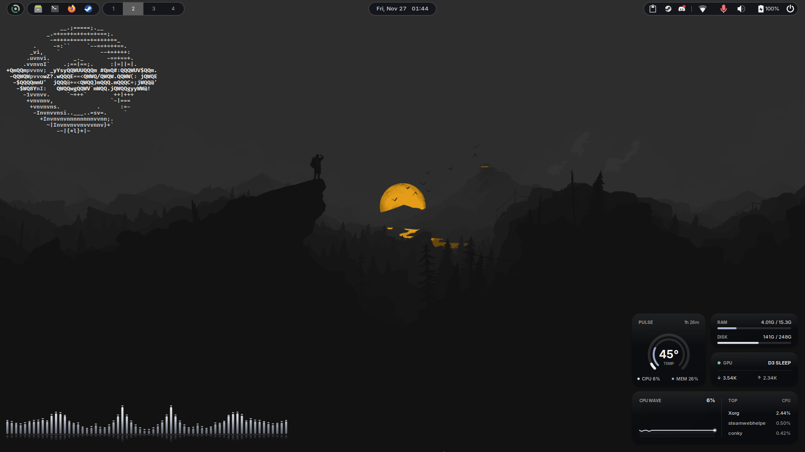
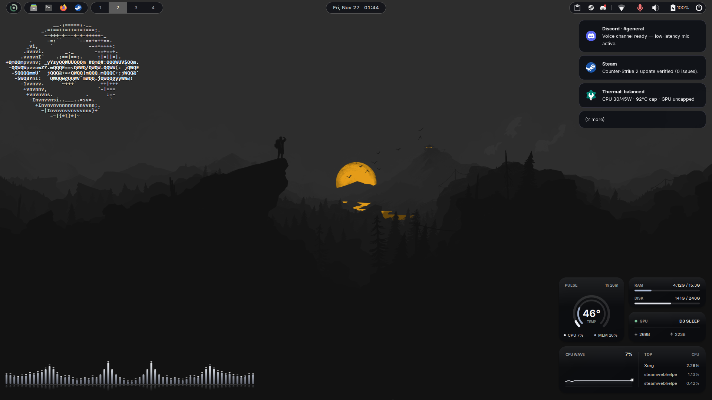
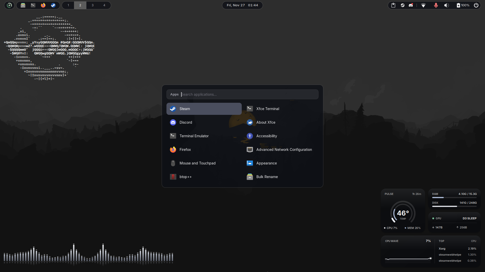
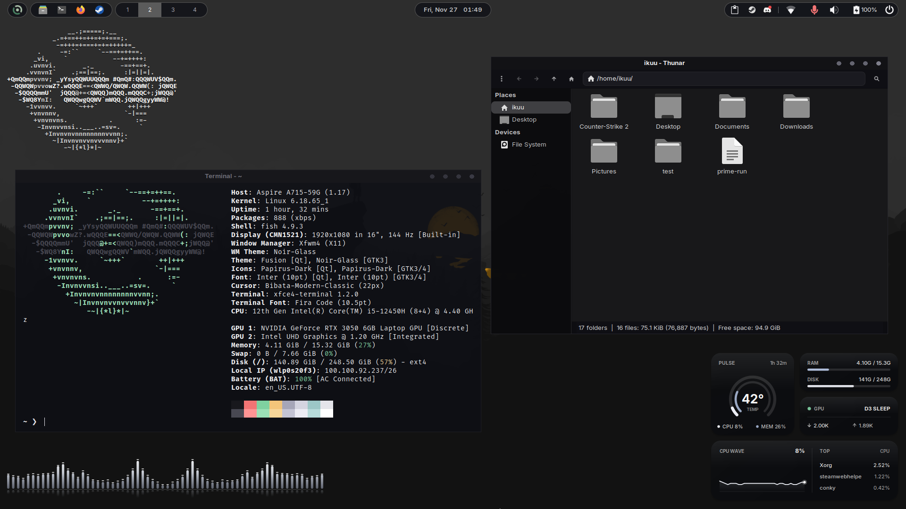

# void-noir-glass

Modular, idempotent post-install provisioning repository for **Void Linux (`x86_64` glibc + `runit`)** — building a fast, universal, battery-friendly, gaming-ready **XFCE 4.20 + Noir Glass OS (Stealth Monochrome)** workstation from a minimal Void base install.

Every subsystem is designed for **universal portability** across Intel, AMD, and hybrid NVIDIA laptops, arbitrary screen resolutions, and arbitrary RAM capacities — with zero background bloat and complete visual continuity from LightDM to desktop popups, Conky HUD widgets, Rofi menus, and Fish/Starship terminals.

---

## Screenshots

| Clean Desktop & Widgets | Stacked Multi-Source Notifications |
| :---: | :---: |
|  |  |
| **Frosted Rofi Launcher (`Super` Tap)** | **Translucent Terminal (`fastfetch`) + Thunar** |
|  |  |

---

## Universal Hardware & Display Compatibility

| Dimension | Universal Behavior |
| :--- | :--- |
| **CPU** | Auto-detects **Intel** (`intel-ucode`, `thermald`, `split_lock_detect=off`, `iTCO_wdt` blacklist, RAPL + TCC) and **AMD** (`linux-firmware-amd`, `sp5100_tco` blacklist, `k10temp`/`zenpower`, `amd-pstate` EPP) cleanly. |
| **Integrated Graphics** | Auto-detects Intel (`8086` -> `intel-media-driver` + `mesa-vulkan-intel`) and AMD (`1002` -> `mesa-vulkan-radeon` + `mesa-vaapi` + `mesa-vdpau`) via `lspci` PCI vendor IDs. |
| **Discrete NVIDIA (Optional)** | `--only`/`--all` installs `nvidia580` (or custom `--nvidia-pkg`) with `D3cold` runtime sleep (`0 W`), OR `--skip nvidia` runs cleanly on Intel/AMD-only laptops. |
| **Display Resolution & Refresh Rate** | Panel island coordinates (`MID_X = SCR_W / 2`, `RIGHT_X = SCR_W - 1`) and `setup-gaming-display.sh` (`<= NAT_W × NAT_H` at preferred native Hz) compute dynamically from `xrandr --current` (tested on `1920x1080@144Hz`; scales cleanly to `1366x768`, `2560x1440`, `2560x1600`, `3840x2160`). |
| **Memory & Limits** | `vm.min_free_kbytes` is computed dynamically (`1%` of `MemTotal`, clamped to `64–256 MiB`) into `/etc/sysctl.d/99-gaming-mem.conf`; PAM `nice -10` applies universally via `@gamemode` and `@wheel`. |
| **Network Interfaces** | Conky HUD reads `/proc/net/route` dynamically (tracks Wi-Fi `<->` Ethernet switches with zero forks); `wifi-status.sh` reads sysfs + nl80211 (`iw`) passively without D-Bus polling or active scans. |

---

## Quick Start

```sh
git clone https://github.com/yourname/void-noir-glass.git
cd void-noir-glass

# 1. Safely preview every command & file install (no root required)
./install.sh --all --dry-run

# 2. Full reproducible build from a fresh Void base install
sudo ./install.sh --all

# 3. Or launch interactive module selection
sudo ./install.sh
```

### CLI Options & Modular Runs

```sh
# Run only the Noir Glass OS desktop rice
sudo ./install.sh --only rice

# Intel/AMD laptop (skip hybrid NVIDIA driver & RTD3 setup)
sudo ./install.sh --skip nvidia

# Run only base system tuning + gaming stack without Discord
sudo ./install.sh --only base,gaming --no-discord

# Override target user, Void CDN mirror, or NVIDIA package branch
sudo ./install.sh --all --user alice --mirror https://repo-fastly.voidlinux.org --nvidia-pkg nvidia580

# Keep SSH password auth enabled if managing locally without SSH keys
sudo ./install.sh --all --no-ssh-hardening

# Run any individual module directly standalone
sudo ./modules/40-rice.sh
```

| Flag | Description |
| :--- | :--- |
| `--all` | Run all 6 modules in canonical order (`00` through `50`). |
| `--only <list>` | Comma-separated subset of modules (`repos,base,desktop,nvidia,rice,gaming`). |
| `--skip <list>` | Run all modules except those listed. |
| `--list` | Print all available modules and exit. |
| `--user <name>` | Override target desktop user (default: `$SUDO_USER` or first UID `>= 1000` login user). |
| `--mirror <url>` | Override Void mirror base URL (default: `https://repo-fastly.voidlinux.org`). |
| `--nvidia-pkg <pkg>` | Choose NVIDIA driver package (default: `nvidia580`). |
| `--no-discord` | Skip `/opt/discord` installation in `gaming`. |
| `--no-ssh-hardening` | Skip key-only SSH drop-in in `base`. |
| `--dry-run` | Print every action cleanly without modifying the system or requiring root. |

---

## Repository Tree & Complete Manual Guide

```text
void-noir-glass/
├── install.sh                               # Main orchestrator CLI (--all, --only, --skip, --dry-run)
├── lib/common.sh                            # Shared helpers (logging, xbps, runit, GRUB, session exec, HW detect)
├── modules/
│   ├── 00-repos.sh                          # Nonfree/multilib repos + Fastly CDN mirrors
│   ├── 10-base.sh                           # Core services, PipeWire mic-perf, NM low-latency Wi-Fi, TLP, thermal-profile, zram, UFW, SSH
│   ├── 20-desktop.sh                        # Xorg, Intel/AMD graphics, XFCE 4.20, LightDM, Firefox, Thunar, mpv, lid-lock
│   ├── 30-nvidia-hybrid.sh                  # Hybrid NVIDIA nvidia580, RTD3 0W D3cold, prime-run, dracut/GRUB
│   ├── 40-rice.sh                           # Noir Glass OS GTK/XFWM4/Qt/Rofi/Dunst/Conky/Cava theme & 3 top islands
│   └── 50-gaming.sh                         # Steam, 32-bit drivers, GameMode, MangoHud, Discord, BBR+fq_codel, 4:3 modes
├── configs/
│   ├── dracut/nvidia.conf                   # Omit nouveau & early NVIDIA modules from initramfs for fast RTD3 boot
│   ├── elogind/
│   │   ├── 10-lock.sh                       # Lock LightDM seat immediately before suspend/lid-close
│   │   └── 20-thermal-profile.sh            # Re-apply saved CPU/GPU thermal limits after suspend/hibernate resume
│   ├── gamemode/gamemode.ini                # GameMode renice (+10), I/O priority 0, screensaver inhibit, governor hints
│   ├── limits/99-gaming.conf                # Universal PAM ulimits: nofile=524288, memlock=2GiB, nice -10 (@gamemode/@wheel)
│   ├── mangohud/MangoHud.conf               # Monochrome MangoHud FPS/frametime/temp overlay (Right Shift + F12)
│   ├── modprobe/
│   │   ├── bbr-modules-load.conf            # Load tcp_bbr and sch_fq_codel at boot
│   │   ├── iwlwifi-perf.conf                # Intel Wi-Fi: power_save=0, uapsd_disable=1, iwlmvm power_scheme=1
│   │   └── nvidia-hybrid.conf               # Nouveau blacklist + NVreg_EnableGpuFirmware=0 + DynamicPowerManagement=0x02
│   ├── mpv/mpv.conf                         # VA-API hardware decode on iGPU (keeps playback cool & dGPU asleep)
│   ├── networkmanager/
│   │   ├── dns.conf                         # Clean NetworkManager native resolv.conf handling (dns=default)
│   │   └── 20-wifi-perf.conf                # Disable Wi-Fi powersave (wifi.powersave=2) & MAC scan thrashing
│   ├── pipewire/51-disable-suspension.conf  # Zero idle suspend delay on alsa_input.* (mic) and alsa_output.* (DAC)
│   ├── ssh/99-hardening.conf                # Key-only SSH auth (only installed when authorized_keys is verified non-empty)
│   ├── sudoers/thermal-profile              # Passwordless wheel allowlist for thermal-profile subcommands
│   ├── sysctl/99-gaming.conf                # vm.max_map_count, swappiness=10, fq_codel+BBR, watchdogs off
│   ├── tlp/
│   │   ├── 01-wifi.conf                     # Disable Wi-Fi powersave + denylist Wi-Fi/NIC PCIe runtime PM
│   │   ├── 02-bluetooth.conf                # Soft-block unused Bluetooth radio on startup
│   │   ├── 03-nvidia-rtd3.conf              # RUNTIME_PM_ON_AC/BAT=auto so NVIDIA RTX GPU enters 0W D3cold on AC & battery
│   │   └── 04-audio-perf.conf               # USB audio exclusion + HDA runtime PM config paired with udev 82-audio-perf
│   └── udev/
│       ├── 60-schedulers.rules              # Low-latency I/O schedulers: kyber (NVMe/SSD), bfq (HDD/SD)
│       ├── 80-nvidia-pm.rules               # Dynamic PCI runtime PM control for NVIDIA VGA/3D/HDMI audio functions
│       ├── 81-net-pm.rules                  # Pin all PCIe Wi-Fi & Ethernet controllers to power/control=on
│       └── 82-audio-perf.rules              # Pin non-NVIDIA HDA audio controllers & codecs to power/control=on (never blocks dGPU D3cold)
├── rice/
│   ├── theme-tokens.json                    # Single source of truth for palette, typography, radii, icon sizes & wallpapers
│   ├── base-dark.css                        # Cached dark GTK3 CSS base (zero external Arc-Theme runtime build deps)
│   └── apply-theme.py                       # Generates Noir-Glass GTK3/XFWM4, GTK4, Qt5/6, Rofi, Dunst, Conky/Cava, Fish, Starship & LightDM
├── scripts/
│   ├── prime-run                            # NVIDIA PRIME offload launcher + NVAPI + shader cache + frame rate hint
│   ├── screenshot-region.sh                 # Interactive maim selection -> ~/Pictures/Screenshots + clipboard + toast
│   ├── setup-gaming-display.sh              # Dynamic native-Hz 4:3 stretched panel-fitter modes for CS2/competitive FPS
│   └── thermal-profile                      # CPU RAPL/TCC/EPP + ACPI platform + NVIDIA clock limiter (CLI + Rofi)
└── assets/                                  # Verified production screenshots rendered in this README
```

---

## Script & Module Reference

### Core Installer & Helper Library

- **[`install.sh`](install.sh):** Parses CLI flags (`--all`, `--only`, `--skip`, `--list`, `--user`, `--mirror`, `--nvidia-pkg`, `--no-discord`, `--no-ssh-hardening`, `--dry-run`) or prompts interactively on a TTY, validates module names, resolves the target desktop user, and executes selected `modules/*.sh` scripts sequentially.
- **[`lib/common.sh`](lib/common.sh):** Provides ANSI-safe logging (`printf --`), dry-run wrappers (`run_cmd`, `xbps_install`, `install_file`, `enable_service`), active graphical session execution (`run_in_user_session`), unified live-or-headless TTY XFCE config writer (`run_xfconf_session`, using `dbus-run-session` when no `xfce4-session` is running), regex-safe idempotent GRUB updates (`grub_add_param` / `grub_commit`), CPU/GPU hardware detection (`cpu_vendor`, `gpu_vendors`), and running kernel package detection (`detect_kernel_headers_pkg`, `detect_running_kernel_pkg`).

### Installation Modules (`modules/`)

1. **[`modules/00-repos.sh`](modules/00-repos.sh):** Installs `void-repo-nonfree`, `void-repo-multilib`, and `void-repo-multilib-nonfree`, rewrites `/etc/xbps.d/*repository*.conf` to the selected Void CDN mirror (`https://repo-fastly.voidlinux.org` by default), and refreshes repository indexes.
2. **[`modules/10-base.sh`](modules/10-base.sh):** Installs core daemons and universal hardware tunings so **every** machine (even without NVIDIA or gaming) receives them:
   - `dbus`, `elogind`, `polkit`, `NetworkManager`, `iw`, `iproute2`, `lsof`, `tlp`, `chrony`, `zramen` (50% ZSTD RAM swap), `socklog-void`, `cronie` + weekly `fstrim`, `noatime` on ext4 `/` & `/boot`, `ufw` (idempotent default-deny + rate-limited SSH `22/tcp`), `os-prober` in GRUB, and guarded key-only SSH hardening.
   - Configures PipeWire + WirePlumber (`10-wireplumber.conf`, `20-pipewire-pulse.conf`, ALSA bridges, `/etc/xdg/autostart/pipewire.desktop`, and `51-disable-suspension.conf` so mic/DAC streams never idle-sleep).
   - Deploys low-latency Wi-Fi (`dns.conf`, `20-wifi-perf.conf`, `iwlwifi-perf.conf`, `81-net-pm.rules`), full-performance audio (`04-audio-perf.conf`, `82-audio-perf.rules`), and `/usr/local/bin/thermal-profile` + passwordless wheel sudoers (`/etc/sudoers.d/zz-thermal-profile`) + boot (`rc.local`) and sleep-resume hooks.
   - Enables `intel-ucode` + `thermald` on Intel CPUs or `linux-firmware-amd` on AMD CPUs.
3. **[`modules/20-desktop.sh`](modules/20-desktop.sh):** Installs minimal `xorg`, auto-detected Intel (`intel-media-driver` + `mesa-vulkan-intel`) and/or AMD (`mesa-vulkan-radeon` + `mesa-vaapi` + `mesa-vdpau`) drivers, auto-detected QEMU/KVM `spice-vdagent` (`spice-vdagentd`) for automatic VM resize and clipboard sharing, minimal XFCE 4.20 (`xfwm4`, `xfce4-session`, `xfce4-panel`, `xfce4-settings`, `xfdesktop`, `xfconf`, `Thunar`, `xfce4-docklike-plugin`, `xfce4-pulseaudio-plugin`, `xfce4-clipman-plugin`, `xfce4-genmon-plugin`, `xfce4-power-manager`, `xfce-polkit`), `lightdm` + `lightdm-gtk-greeter`, `gvfs` (`mtp`/`smb`/`ntfs-3g`), `tumbler`, `xdg-desktop-portal-gtk`, `firefox`, `xfce4-terminal`, `pavucontrol`, `mpv`, `ristretto`, `mousepad`, `xarchiver`/`7zip`, plus automatic `dm-tool lock` before lid-close/suspend (`/etc/elogind/system-sleep/10-lock.sh`) and `run_xfconf_session` pre-seeding even on fresh TTY installs.
4. **[`modules/30-nvidia-hybrid.sh`](modules/30-nvidia-hybrid.sh):** Installs NVIDIA driver (`nvidia580` by default) + matching kernel headers, `configs/modprobe/nvidia-hybrid.conf` (`NVreg_EnableGpuFirmware=0` + `NVreg_DynamicPowerManagement=0x02` for true 0 W `D3cold`), `configs/dracut/nvidia.conf`, `configs/udev/80-nvidia-pm.rules`, `configs/tlp/03-nvidia-rtd3.conf`, `/usr/local/bin/prime-run`, GRUB KMS/blacklist flags, enables `nvidia-powerd`, and rebuilds the initramfs for the running kernel.
5. **[`modules/40-rice.sh`](modules/40-rice.sh):** Installs `rofi`, `dunst`, `starship`, `fish-shell`, `conky`, `cava`, `playerctl`, `xcape`, `wmctrl`, `xdotool`, `maim`, `xclip`, `qt5ct`, `qt6ct`, monochrome `Papirus-Dark` (`grey` folders), `Bibata-Modern-Classic` cursor, Inter / Fira Code / Nerd Fonts Symbols, and 3 dark 4K wallpapers. Works cleanly both on live X11 sessions and headlessly from a fresh TTY install via `run_xfconf_session` (`dbus-run-session`), pre-seeding `xfce4-panel` `/configver = 2` and keyboard shortcut `override = true` defaults so first graphical login never resets the layout, removes `xfce4-notifyd` so Dunst owns notifications, configures top 3 islands (`size=42`, `icon-size=20`), Docklike pins, `xfce4-terminal`, XFWM4 native compositor (`xpresent`, `unredirect_overlays=true`), multi-output wallpaper, and restarts live daemons when X11 is active.
6. **[`modules/50-gaming.sh`](modules/50-gaming.sh):** Installs `steam`, `steam-udev-rules`, matching 32-bit Vulkan/GL/PipeWire libraries, `gamemode`, `MangoHud`, `Vulkan-Tools`, and optional official native `/opt/discord` (with `OPEN_ON_STARTUP: false`, `MINIMIZE_TO_TRAY: true`). Applies `99-gaming.conf` sysctl + dynamically computes `vm.min_free_kbytes` into `/etc/sysctl.d/99-gaming-mem.conf`, loads `tcp_bbr` + `sch_fq_codel`, applies `kyber`/`bfq` I/O schedulers (`60-schedulers.rules`), PAM limits (`99-gaming.conf`), Transparent Hugepages (`always` + `defer+madvise`), CPU watchdog/split-lock GRUB flags, GameMode & MangoHud configs, and `setup-gaming-display.sh` (`144Hz` / native-Hz 4:3 modes).

### Theme Engine & Runtime Helpers (`rice/` & `scripts/`)

- **[`rice/theme-tokens.json`](rice/theme-tokens.json):** Central JSON design tokens (`bg_glass`, borders, accent `#E4E4EA`, status colors, `bar_height: 42`, `bar_icon_size: 20`, `dock_icon_size: 20`, fonts, and wallpapers).
- **[`rice/apply-theme.py`](rice/apply-theme.py):** Reads tokens + `base-dark.css` and generates:
  - `/usr/share/themes/Noir-Glass` (pixel-art vector XFWM4 window chrome + stealth monochrome GTK3 theme)
  - `~/.config/gtk-3.0/gtk.css` (32 px floating glass pills inside 42 px panels, horizontal single-row `pulseaudio-button`, translucent Thunar, frosted Alt+Tab dock, calendar/menu popups)
  - `~/.config/gtk-4.0/`, `~/.config/qt5ct/`, `~/.config/qt6ct/`, `/etc/lightdm/lightdm-gtk-greeter.conf`
  - `~/.config/rofi/` (`config.rasi`, `noir-glass.rasi`, `powermenu.sh`, `wifi-menu.sh`)
  - `~/.config/dunst/dunstrc` (dedicated top-right stack with `notification_limit = 4`, `indicate_hidden = yes`)
  - `~/.config/conky/` (`card.lua`, `telemetry.conf`, `void_ascii.conf`, `spectrum.conf`, `cava_feeder.sh`, `gpu_status.sh`, `cpu_temp.sh`, `music_info.sh`, `start.sh` with dynamic `SCR_W`-clamped spectrum width so it never collides with Bento HUD even at `1024x768`)
  - `~/.local/bin/noir-glass-display-sync.sh` + autostart (syncs center/right panel island anchors and any newly attached/VM outputs on first login and live resolution changes)
  - `~/.local/bin/wifi-status.sh` (zero-scan passive `sysfs` + `iw` panel monitor)
  - `~/.local/bin/auto-compositor.sh` (PID-locked `xprop -spy` event loop disabling XFWM4 compositing only when a fullscreen game focuses and triggering display + Conky sync on `_NET_DESKTOP_GEOMETRY` changes)
  - `~/.config/fish/config.fish` & `~/.config/starship.toml`
- **[`scripts/thermal-profile`](scripts/thermal-profile):** Snapshots factory power limits cleanly on first run (`/etc/thermal-profile.factory`) and switches live between `quiet`, `balanced`, `cool-game`, and `stock` across Intel RAPL (MSR + MMIO), hardware TCC Offset, Intel/AMD EPP, ACPI `platform_profile`, and NVIDIA clock caps — without waking a `D3cold` sleeping dGPU.
- **[`scripts/setup-gaming-display.sh`](scripts/setup-gaming-display.sh):** Sets `scaling mode: Full` (smooth hardware panel-fitter stretched 4:3, zero black bars) and attaches native-Hz 4:3 modes (`1440x1080`, `1280x960`, `1152x864`, `1024x768`) up to the panel's native dimensions.
- **[`scripts/prime-run`](scripts/prime-run):** Sets NVIDIA PRIME render offload + Vulkan layer + persistent shader cache + `__GL_CONSTANT_FRAME_RATE_HINT=3` + Proton NVAPI variables.
- **[`scripts/screenshot-region.sh`](scripts/screenshot-region.sh):** Interactive `maim -s` capture copied directly to clipboard (`xclip`) and saved to `~/Pictures/Screenshots/`.

---

## Desktop Geometry & Zero-Overlap Layout

Every desktop element occupies its own exclusive screen zone so stacked notifications, HUD widgets, panels, and visualizers never collide at `1920x1080` or smaller laptop panels (`1366x768`+):

- **Top Edge (`y = 0..42`):** 3 non-overlapping auto-sized floating glass islands:
  - **Left (`p=6;x=0;y=0`):** Void launcher -> Docklike pinned apps (`Thunar`, `Terminal`, `Firefox` + open windows) -> Workspaces `1 2 3 4`
  - **Center (`p=9;x=SCR_W/2;y=0`):** Date & Time + frosted Calendar popup
  - **Right (`p=2;x=SCR_W-1;y=0`):** `[Clipboard] [App Tray] | [Wi-Fi] [Mic+Volume] [Battery %] [Power]`
- **Top-Left (`gap_x=14, gap_y=58`):** Void monochrome ASCII art identity (`390x274`).
- **Top-Right Corridor (`origin=top-right, offset=(16, 54)`):** Exclusive Dunst stacked notification lane (`width=340`, `height=(0,120)`, `notification_limit=4` with summary counter when 5+ arrive simultaneously).
- **Bottom-Right (`alignment=bottom_right, gap_x=4, gap_y=6`):** Asymmetric Bento Glass Telemetry HUD (`420x336`) — CPU/RAM dual rings, package temperature, dynamic GPU status (`D3 SLEEP` at 0 W when idle), live net down/up on the active default route, CPU waveform, and top 3 processes. Never touches the top-right notification stack.
- **Bottom-Left (`alignment=bottom_left, gap_x=10, gap_y=18`):** Frameless 64-bar Cava spectrum visualizer (`up to 680x128`, automatically clamped to `max(320, min(680, SCR_W - 460))` on login and resolution changes so it never overlaps the Bento HUD even at `1024x768`) with mirror reflections and a dynamic Now Playing glass pill that appears only when `playerctl` is playing/paused.

> **QEMU / KVM Virtual Machines:** `modules/20-desktop.sh` automatically detects QEMU/KVM guests and installs `spice-vdagent` (`spice-vdagentd`) for seamless guest auto-resize and host-guest clipboard sharing. In `virt-manager`, set **Video** to **Virtio** (with 3D disabled for software X11 or default SPICE) rather than legacy `QXL` for noticeably smoother desktop rendering; `noir-glass-display-sync.sh` and `auto-compositor.sh` automatically re-anchor the top islands, Conky spectrum width, and per-output `Virtual-1` wallpaper whenever the VM window resizes.

---

## Keyboard Shortcuts

| Shortcut | Action |
| :--- | :--- |
| `Super` (tap) | Toggle centered frosted Rofi app launcher (`Alt+F1` bound via `xcape`) |
| `Super + Enter` or `Ctrl + Alt + T` | Open `xfce4-terminal` |
| `Super + E` | Open Thunar file manager (`Ctrl + M` toggles menubar) |
| `Super + T` | Open Noir Glass Thermal Profile picker (`quiet` / `balanced` / `cool-game` / `stock`) |
| `Super + X` | Open Noir Glass Power Menu (Lock / Suspend / Log Out / Reboot / Shutdown) |
| `Super + V` | Open Clipman clipboard history popup |
| `Super + Shift + S` | Interactive region screenshot -> save + clipboard + toast |
| `Super + D` | Show / hide desktop (widgets & islands remain intact) |
| `Super + Q` | Close active window |
| `Super + Left / Right / Up` | Snap left / snap right / maximize |
| `Super + 1..4` | Switch workspace 1–4 |
| `Right Shift + F12` | Toggle MangoHud overlay inside games |

---

## Operational Guides

### 1. Thermal Profiles (`Super + T` or `thermal-profile`)

| Profile | CPU PL1 / PL2 | Temp Ceiling | EPP | NVIDIA Cap | Best For |
| :--- | :--- | :--- | :--- | :--- | :--- |
| `quiet` | `15 W / 22 W` | `80°C` | `balance_power` | `1050 MHz` | Silent browsing & battery life |
| `balanced` *(default)* | `30 W / 45 W` | `92°C` | `balance_performance` | Uncapped | Daily work, desktop & CS2 |
| `cool-game` | `25 W / 30 W` | `85°C` | `balance_performance` | `1450 MHz` | Heavy AAA GPU+CPU games on shared heatpipes |
| `stock` | Factory (`45 / 115 W` default) | `95°C` | `balance_performance` | Uncapped | Short all-core burst benchmarks |

```sh
thermal-profile status        # Inspect live temps, limits, and D3cold GPU state (never wakes sleeping GPU)
thermal-profile cool-game     # Apply via wheel NOPASSWD sudo and notify
```

### 2. Steam Launch Options & Gaming

```sh
# Hybrid NVIDIA RTX + GameMode (for CS2, use CMAA2 or None instead of MSAA — Valve bug #4176)
prime-run gamemoderun %command%

# With toggleable monochrome MangoHud overlay (Right Shift + F12)
prime-run gamemoderun mangohud %command%
```

### 3. Low-Latency Wi-Fi Stack (Hardware + NM + Qdisc)

Latency spikes (200–1000+ ms) on Linux laptops typically stem from four compounding defaults: firmware `power_save` / U-APSD sleep, `iwlmvm power_scheme=2`, periodic D-Bus/MAC-randomizing scans, and PCIe ASPM/runtime suspend on the wireless NIC. `void-noir-glass` eliminates all four universally via:

1. `configs/modprobe/iwlwifi-perf.conf` -> `power_save=0 uapsd_disable=1` + `iwlmvm power_scheme=1`
2. `configs/networkmanager/20-wifi-perf.conf` -> `wifi.powersave=2` + `wifi.scan-rand-mac-address=no`
3. `configs/tlp/01-wifi.conf` + `configs/udev/81-net-pm.rules` -> keeps PCIe Wi-Fi/Ethernet `power/control=on`
4. `configs/sysctl/99-gaming.conf` + `configs/modprobe/bbr-modules-load.conf` -> `fq_codel` + `tcp_bbr`
5. `~/.local/bin/wifi-status.sh` -> passive `sysfs` + `iw` panel polling with **zero scans** (active scans occur only when clicking **Rescan Networks** inside the Rofi Wi-Fi menu).

> **Note for single-AP environments:** On noisy 2.4 GHz access points or meshes, locking the profile to your preferred AP's BSSID (`nmcli con modify <SSID> 802-11-wireless.bssid <BSSID>`) stops `wpa_supplicant` background roaming scans completely while keeping 5 GHz/roaming unaffected elsewhere.

### 4. Full-Performance Audio/Mic + True 0 W NVIDIA D3cold Coexistence

Setting global `snd_hda_intel power_save=0` would prevent NVIDIA's HDMI audio function (`01:00.1`, which shares the `snd_hda_intel` driver) from entering runtime suspend, blocking the discrete NVIDIA GPU (`01:00.0`) from `D3cold` sleep (~6 W idle drain). Instead, `void-noir-glass`:

- Uses `configs/udev/82-audio-perf.rules` to match **device attributes directly**: every non-NVIDIA PCI audio controller (`ATTR{vendor}!="0x10de"`) and HDA codec (`ATTR{vendor_id}!="0x10de*"`, e.g. Realtek ALC256 mic/headphone codec) is pinned to `power/control=on`, while NVIDIA HDMI (`0x10de*`) stays `auto` (`suspended`).
- Disables idle stream suspension in WirePlumber (`configs/pipewire/51-disable-suspension.conf`: `session.suspend-timeout-seconds = 0` on `alsa_input.*` & `alsa_output.*`) and excludes USB audio DACs (`USB_EXCLUDE_AUDIO=1` in TLP).
- Keeps `xfce4-pulseaudio-plugin` locked into **horizontal** single-row layout (`bar_height: 42`, `bar_icon_size: 20`) so the recording microphone icon and speaker icon sit cleanly side-by-side in the glass capsule.

### 5. Customizing Theme Tokens

Edit `~/.config/noir-glass/theme-tokens.json` and regenerate cleanly:

```sh
python3 ~/.config/noir-glass/apply-theme.py \
  --tokens ~/.config/noir-glass/theme-tokens.json \
  --home "$HOME" \
  --system-root /
sudo cp -r ~/.themes/Noir-Glass /usr/share/themes/Noir-Glass
```

---

## Verification & Troubleshooting Commands

```sh
# Check discrete GPU sleeps at 0 W and internal audio/Wi-Fi stay awake (on)
cat /sys/bus/pci/devices/0000:01:00.0/power/runtime_status   # expected: suspended (idle)
cat /sys/bus/pci/devices/0000:00:1f.3/power/control          # expected: on
cat /sys/bus/pci/devices/0000:00:14.3/power/control          # expected: on

# Check Intel Wi-Fi & qdisc latency settings
iw dev "$(iw dev | awk '$1=="Interface"{print $2; exit}')" get power_save
cat /sys/module/iwlwifi/parameters/{power_save,uapsd_disable} /sys/module/iwlmvm/parameters/power_scheme
sysctl net.core.default_qdisc net.ipv4.tcp_congestion_control vm.min_free_kbytes

# Verify single WirePlumber instance & active audio nodes
pgrep -c wireplumber && wpctl status

# Test GameMode daemon & verify 4:3 native-Hz modes
gamemoded -t
xrandr --query | grep -E '1440x1080|1280x960|1152x864|1024x768'
```
